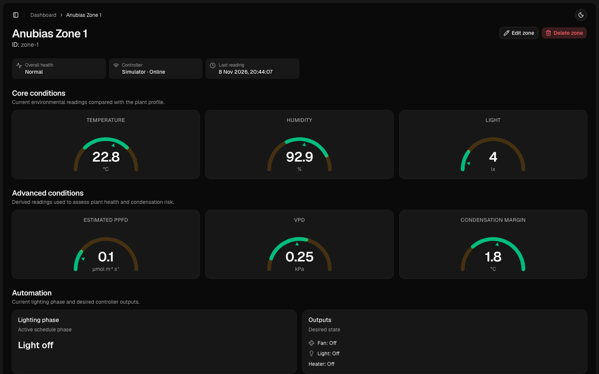

# Grow Node

Grow Node is a local-first IoT monitoring demo that connects simulated or physical environmental sensors to a web dashboard through MQTT, backend services, and PostgreSQL.

The repository is designed as a portfolio project: a reviewer can run the complete system locally with Docker and see live telemetry without owning an ESP32 or configuring a cloud account.

> **Status:** MVP complete and ready for public release. The end-to-end demo, quality checks, clean-start workflow, and repository safety review are complete.



## What it demonstrates

- a complete telemetry flow across several independently responsible services;
- MQTT messaging with shared, validated payload contracts;
- backend ingestion, state evaluation, and PostgreSQL persistence;
- a dashboard-facing HTTP API;
- a server-rendered Next.js dashboard;
- complete local management of zones and plant profiles;
- a hardware-free simulator for reproducible local demos;
- optional ESP32 firmware using the same MQTT contract;
- Docker-based local orchestration and automatic database setup.

## Architecture

```text
Simulator or ESP32 firmware
        │
        │ telemetry, heartbeat, command acknowledgements
        ▼
Mosquitto MQTT broker
        │
        ▼
Control service ──────────────► PostgreSQL
        │                            ▲
        │ automatic commands         │ reads
        ▼                            │
Simulator or ESP32              API service
                                     ▲
                                     │ HTTP
                                     │
                              Next.js dashboard
```

The service boundaries are intentional:

- the **simulator** behaves like a controller and makes the demo hardware-independent;
- the **control service** consumes MQTT messages, validates telemetry, stores readings, and evaluates zone state;
- **PostgreSQL** stores zones, profiles, telemetry, current state, and command history;
- the **API service** is the dashboard's only backend interface;
- the **dashboard** presents system state and never connects directly to MQTT or Prisma;
- the optional **ESP32 firmware** can replace the simulator without changing the rest of the architecture.

## Technology

- Next.js, React, TypeScript, and Tailwind CSS
- Node.js and Fastify
- PostgreSQL and Prisma
- MQTT and Eclipse Mosquitto
- Zod shared contracts
- Docker Compose
- Vitest
- ESP32, C++, and PlatformIO
- pnpm workspaces

## Quick start

### Requirements

- Docker Desktop or Docker Engine with Compose
- Git

### Run the complete demo

```bash
git clone https://github.com/rastislavelias/grow-node.git
cd grow-node
docker compose up --build
```

Open:

- dashboard: <http://localhost:3000>
- API health: <http://localhost:4000/health>

The first start builds the application images, waits for PostgreSQL, applies Prisma migrations, creates idempotent demo data, and starts the simulator. No manual database command is required.

`grow-node-db-setup` is a one-shot container. An `Exited (0)` status for that service means database setup completed successfully.

### Stop the demo

```bash
docker compose down
```

The PostgreSQL data volume is preserved. To deliberately reset all local database data, use `docker compose down -v`.

## Expected demo behaviour

The public MVP is centred on one simulated grow zone. The simulator publishes a heartbeat and fresh temperature, humidity, and light readings every five seconds.

The dashboard shows:

- overall system health;
- controller connectivity and last reading time;
- core temperature, humidity, and light readings;
- advanced PPFD, VPD, and condensation-margin readings;
- evaluated zone state;
- desired fan, light, and heater state;
- recent telemetry and command history;
- automatic five-second refresh on monitoring views.

The local dashboard also supports complete plant-profile management and zone registration, editing, assignment, and confirmed deletion. These controls are intentionally unauthenticated and local-only for the portfolio MVP; they are not presented as production device provisioning.

The simulator allows the complete pipeline to be reviewed without physical hardware. The ESP32 implementation is included as an optional extension of the same contract.

## Repository structure

```text
apps/dashboard              Next.js dashboard
services/api                Dashboard-facing Fastify API
services/control            MQTT ingestion and decision logic
services/simulator          Simulated telemetry and controller behaviour
packages/contracts          Shared Zod schemas and TypeScript types
packages/db                 Prisma schema, migrations, seed, and client
firmware/grow-node-zone     Optional ESP32 firmware
infra/mosquitto             Local Mosquitto configuration
docs/project-scope.md       MVP boundaries and release checklist
```

## Useful commands

```bash
# Start or rebuild the demo in the background
docker compose up --build -d

# Check service state
docker compose ps -a

# Follow application logs
docker compose logs -f api control simulator dashboard

# Stop services while preserving database data
docker compose down
```

For host-side quality checks, use Node.js 24 and the pnpm version declared in `package.json`:

```bash
corepack enable
pnpm install --frozen-lockfile
pnpm format:check
pnpm lint
pnpm typecheck
pnpm test
```

## API overview

The API exposes these dashboard-facing HTTP endpoints:

```text
GET  /health
GET  /plant-profiles
GET  /plant-profiles/:plantProfileId
POST /plant-profiles
PUT  /plant-profiles/:plantProfileId
DELETE /plant-profiles/:plantProfileId
GET  /zones
POST /zones
GET  /zones/:zoneId
PUT  /zones/:zoneId
DELETE /zones/:zoneId
GET  /zones/:zoneId/telemetry
GET  /zones/:zoneId/commands
POST /zones/:zoneId/commands
PUT  /zones/:zoneId/plant-profile
```

MQTT and HTTP payloads are defined and validated in `packages/contracts` rather than duplicated across services.

## Optional ESP32 firmware

The firmware in `firmware/grow-node-zone` reads environmental sensors, publishes telemetry and heartbeat messages, receives output commands, and sends acknowledgements.

It is built separately with PlatformIO and is not part of the pnpm workspace or required for the local demo. See [the firmware README](firmware/grow-node-zone/README.md) for hardware and upload instructions.

## MVP boundaries

This project intentionally does not aim to provide authentication, cloud deployment, multi-tenancy, production device provisioning, alerting, advanced analytics, or automated plant-care recommendations.

The first public release focuses on one clear outcome: a complete, locally reproducible IoT-style data flow that is easy to run and understand.

See [the MVP scope](docs/project-scope.md) for the release checklist, explicit exclusions, and definition of done.

## AI-assisted development

AI tools have been used as development assistants for planning, debugging, review, and documentation. Architecture decisions, implementation choices, verification, and final code quality remain the developer's responsibility.
